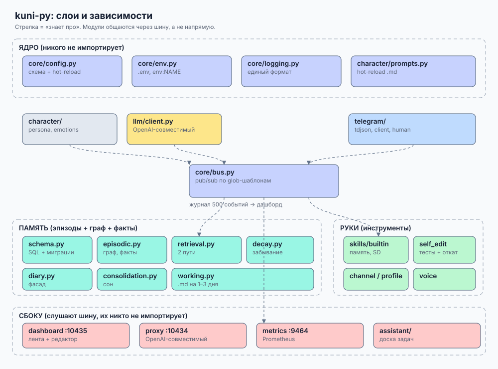
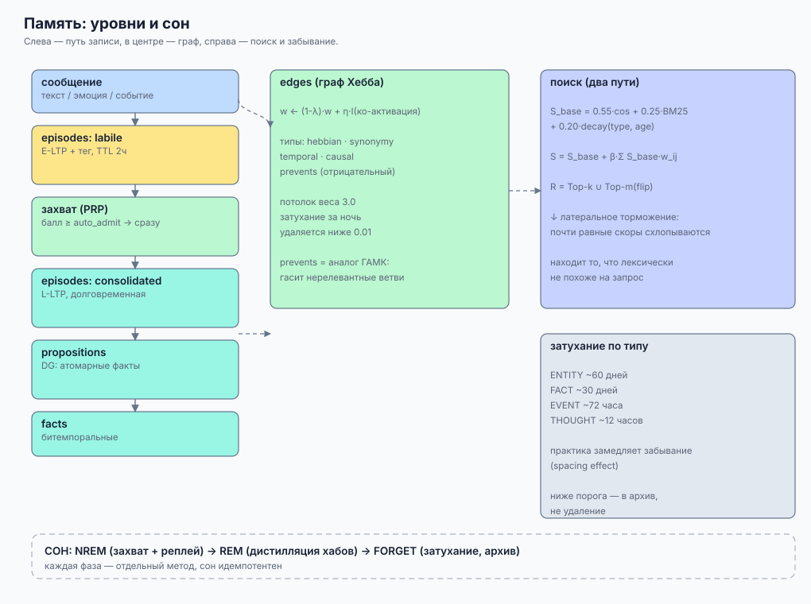

# kuni-py

<p align="center">
  
</p>

<p align="center">
  <a href="https://www.python.org/downloads/"></a>
  <a href="https://core.telegram.org/tdlib"></a>
  
  
</p>

> [!WARNING]
> **Проект находится в активной разработке (Work in Progress / Experimental Research). Просьба делиться наработками))**  
> Архитектура когнитивных процессов, формулы аффекта и алгоритмы консолидации памяти непрерывно дорабатываются и тестируются в боевых условиях. Некоторые интерфейсы могут меняться.

**kuni-py** — модульный автономный AI-персонаж (компаньон), живущий в Telegram через **настоящий клиент TDLib** (полноценный аккаунт, а не ограниченный Bot API).

В отличие от классических чат-ботов и ассистентов, проект построен вокруг **нейробиологически вдохновлённой когнитивной архитектуры**: биохимическая модель аффекта на моноаминах с решением ОДУ в реальном времени, трёхслойная ассоциативная память с графом Хебба и двухконтурным поиском, трёхфазная ночная консолидация памяти (сон), автономная проактивность и органичное человекоподобное поведение в мессенджере.

Функциональный аналог C++-проекта [kuni](https://github.com/alex2772/kuni), спроектированный с нуля на чистом Python 3.11+ с событийной pub/sub-шиной и строгой изоляцией подсистем.

---

## 📑 Оглавление

- [Архитектура системы](#-архитектура-системы)
- [Модель памяти (Neuro-Memory)](#-модель-памяти-neuro-memory)
- [Аффективный движок и моноамины](#-аффективный-движок-и-моноамины)
- [Биоритмы и ночной сон](#-биоритмы-и-ночной-сон)
- [Человечное поведение в Telegram](#-человечное-поведение-в-telegram)
- [Проактивность и внутренний мир](#-проактивность-и-внутренний-мир)
- [Harness: саморазвитие под контролем](#-harness-саморазвитие-под-контролем)
- [Дашборд, Прокси и Метрики](#-дашборд-прокси-и-метрики)
- [Исследовательская база (Research Packs)](#-исследовательская-база-research-packs)
- [Быстрый старт](#-быстрый-старт)
- [Тестирование](#-тестирование)

---

## 🏛 Архитектура системы

Проект следует принципу слабой связанности (Decoupled Event-Driven Core): подсистемы **не импортируют друг друга напрямую**, а обмениваются типизированными событиями через шину `core/bus.py`.

```
                 ┌──────────────────────────┐
                 │       kuni/app.py        │  сборка и супервизор
                 └────────────┬─────────────┘
     ┌──────────┬─────────────┼─────────────┬──────────┐
     ▼          ▼             ▼             ▼          ▼
  character   memory         llm         telegram   skills
     └──────────┴─────────────┼─────────────┴──────────┘
                              ▼
                   ┌────────────────────┐
                   │    core/bus.py     │  pub / sub event bus
                   └─────────┬──────────┘
              ┌──────────────┼──────────────┐
              ▼              ▼              ▼
          dashboard        proxy         metrics
```

- **Отказоустойчивость:** сбой отдельного модуля не останавливает процесс. При недоступности TDLib работают память, прокси и консольный чат; при недоступности внешней LLM включается безопасная echo-диагностика.
- **Подсистемы:**
  - `kuni/affect/` — биохимическая модель моноаминов (S/N/D), социальная боль, руминация, сон, appraisal по SEC.
  - `kuni/memory/` — эпизоды, хеббовский граф ассоциаций, факты, двухконтурный поиск, забывание.
  - `kuni/character/` — личность, журнал эмоциональных состояний, динамические промпты.
  - `kuni/telegram/` — низкоуровневый C-FFI мост к `tdjson`, имитация человеческого набора (CPS), разделение реплик.
  - `kuni/proactivity/` — спонтанные импульсы, поток подсознательных мыслей, накопление дефицитов внимания.
  - `kuni/harness/` — безопасные инструменты модификации кода и окружения с интерактивным подтверждением через кнопки в Telegram.
  - `kuni/proxy/` — локальный OpenAI-совместимый сервер (`:10434`) для использования персонажа в любых внешних IDE (VS Code Copilot, Cursor).
  - `kuni/dashboard/` — веб-интерфейс реального времени (`:10435`) с координатами PAD, мыслями и состоянием графа.

---

## 🧠 Модель памяти (Neuro-Memory)

Вместо примитивного RAG-векторного хранилища здесь реализован аналог взаимодействия гиппокампа и неокортекса:

<p align="center">
  
</p>

### 1. Трёхслойная структура хранения

| Уровень | Описание | Биологический аналог |
|---|---|---|
| **`episodes`** | Сырые события с временными метками и коротким временем полураспада (TTL 2 часа). | Гиппокамп, E-LTP (ранняя потенциация) |
| **`edges`** | Ассоциативный граф, связывающий сущности и эпизоды по правилу Хебба (*«нейроны, возбуждающиеся вместе, связываются вместе»*). | Поле CA3 гиппокампа, ассоциативная кора |
| **`propositions`** | Атомарные структурированные факты, выделенные из диалогов. | Зубчатая извилина (DG, разделение паттернов) |
| **`facts`** | Долгосрочные семантические знания с битемпоральной валидностью (`valid_time` vs `system_time`). | Неокортекс |

### 2. Двухконтурный поиск с латеральным торможением

Поиск не сводится к банальному косинусному kNN. Финальный скор воспоминания вычисляется по формуле:

$$S = 0.55 \cdot \text{cos}(\vec{q}, \vec{m}) + 0.25 \cdot \text{BM25}(q, m) + 0.20 \cdot \text{Decay}(\text{type}, \Delta t) + \beta \sum_{e \in \text{Edges}} w_e \cdot A_e$$

- **Spreading Activation (Распространение активации):** активация от ключевых сущностей текущего контекста распространяется по взвешенным рёбрам графа. Это позволяет извлечь воспоминания, которые семантически или лексически не совпадают с запросом, но связаны прожитым опытом.
- **Lateral Inhibition (Латеральное торможение):** воспоминания, находящиеся слишком близко друг к другу в семантическом пространстве, взаимно подавляются. Контекст LLM не засоряется дублирующими вариантами одного и того же события.
- **ACT-R Base-Level Learning:** доступность следа памяти растёт с каждым успешным воспроизведением (Ecphory) и логарифмически угасает со временем.

Подробная научная спецификация: [docs/research/03-memory/MEMORY.md](docs/research/03-memory/MEMORY.md).

---

## ❤️ Аффективный движок и моноамины

Настроение персонажа — это не статический текст и не дискретный enum. Это непрерывная динамическая система на базе трёх моноаминов (Serotonin, Noradrenaline, Dopamine):

| Моноамин | Психологическая роль | Базовый уровень | Скорость полураспада ($t_{1/2}$) |
|---|---|---|---|
| **S (Серотонин)** | Эмоциональная стабильность, удовлетворённость, торможение аффекта | `0.62` | ~28 мин |
| **N (Норадреналин)** | Физиологическое возбуждение, бдительность, тревожность | `0.38` | ~2 мин |
| **D (Дофамин)** | Мотивация, инициативность, исследовательский драйв | `0.60` | переменный |

### Численное интегрирование Рунге-Кутты (RK4)

Уравнения баланса нейромедиаторов решаются каждую минуту методом RK4:

$$\frac{d\vec{C}}{dt} = -\Lambda (\vec{C} - \vec{C}_{\text{base}}) + \vec{I}_{\text{stimuli}} + \vec{\eta}(t)$$

Координаты моноаминов однозначно проецируются в трёхмерное пространство **PAD** (Pleasure-Valence, Arousal, Dominance):
- **Valence ($V$):** $V \propto S - N$
- **Arousal ($A$):** $A \propto N + D$
- **Dominance ($D$):** $D \propto D - N$

### Социальная боль и руминация

- **Модель остракизма Уильямса:** социальные события (игнорирование в чате, грубость, удаление из группы, мут) бьют по четырём фундаментальным потребностям: *Belonging (Принадлежность)*, *Self-Esteem (Самооценка)*, *Control (Контроль)*, *Meaningful Existence (Значимость)*.
- **Руминация (Rumination Loops):** задетое состояние не исчезает мгновенно после прекращения раздражителя. Руминационный контур периодически реактивирует аффективный след, продлевая обиду или настороженность.

### Тройное управление генерацией

Аффект определяет речь через три независимых канала:
1. **Параметры сэмплинга:** температура ($T$) и длина ответа (`max_tokens`) масштабируются в зависимости от уровня возбуждения и контроля.
2. **Соматическая директива (`somatic_directive`):** подсказывает модели телесные ощущения (ком в горле при обиде, прилив сил при восторге, сонная вялость).
3. **Стилистическая директива (`style_directive`):** перестраивает темп набора, длину реплик, пунктуацию и склонность к сарказму или молчанию.

Подробная научная спецификация: [docs/research/01-affect/AFFECT.md](docs/research/01-affect/AFFECT.md).

---

## 🌙 Биоритмы и ночной сон

Персонаж живёт по фиксированному биологическому времени (по умолчанию UTC+5) и проходит циркадные циклы.

```
Бодрствование (Day) ──> Wind-down ──> NREM Replay ──> REM Hub Distillation ──> Synaptic Scaling ──> Wake Inertia
```

### Фазы ночной консолидации:

1. **Wind-down (Подготовка ко сну):** падение дофамина, замедление реакций, сонная инерция.
2. **NREM (Медленный сон):** приоритизированный прогон дневного буфера эпизодов (experience replay) на основе эмоционального заряда.
3. **REM (Быстрый сон):** смысловая дистилляция — обнаружение топологических хабов в графе ассоциаций, сжатие разрозненных эпизодов в долгосрочные правила неокортекса, синтез сновидений.
4. **Synaptic Homeostasis (Синаптическое масштабирование):** затухание слабых случайных связей, дедупликация и архивация отработавших данных без безвозвратного удаления.
5. **Wake Inertia (Утреннее пробуждение):** постепенное включение ресурсов, утренний разбор ночной очереди сообщений (`night_queue`).

Ночью персонаж **не спамит в чаты**: все входящие складываются в изолированную базу `night_queue.db` и осмысленно обрабатываются утром с учётом смены настроения.

---

## 💬 Человечное поведение в Telegram

В отличие от стандартных Telegram-ботов, kuni-py работает через юзербот-сессию **TDLib (C-FFI)**:

- **Имитация физического набора:** задержка перед чтением (`read_delay`), вычисление времени набора исходя из человеческого темпа (символов в секунду — CPS), пульсация статуса `chatActionTyping`.
- **Естественное дробление сообщений (`send_humanlike`):** люди не отправляют полотна текста на три экрана. Ответ органично дробится на 1–3 коротких смысловых сообщения с реалистичными паузами.
- **Осознанные цитаты и реакции:** автоматическое принятие решений — когда ответить цитатой, когда поставить эмодзи-реакцию (`#react`), а когда сделать естественную паузу (`#wait`).
- **Мультимодальное восприятие:** встроенный анализатор первого кадра видео-стикеров, декодирование голосовых сообщений (Whisper) и распознавание картинок (Vision LLM).
- **Служебная фильтрация:** игнорирование системных уведомлений (добавление в чат, смена названия), корректная обработка блокировок и мутов.

---

## ⚡ Проактивность и внутренний мир

Персонаж не просто «ждет вопросов»:

- **Импульсы (`proactivity_impulse`):** автономный цикл периодически оценивает накопленные желания и может спонтанно написать важному человеку, поделиться моментом или поставить реакцию.
- **Поток мыслей (`thought_stream`):** фоновый внутренний монолог, видимый на дашборде, отражающий подлинные переживания без маски для собеседника.
- **Потребность в связи (Attachment Engine):** персонаж замечает долгое отсутствие близких людей и начинает скучать в зависимости от силы связи (`w_rel`).

---

## 🛠 Harness: саморазвитие под контролем

В персонаж встроен модуль контролируемого воздействия на внешнюю среду и собственный код:

| Инструмент | Возможности | Ограничения и безопасность |
|---|---|---|
| `fs` | Чтение, запись, точечная правка, поиск файлов | Только в пределах рабочей директории проекта; `.env` и секреты аппаратно закрыты |
| `shell` | Запуск команд (pytest, git diff, python) | Строгий allowlist: запрещены деструктивные команды (`rm -rf`, `git push`, пайпы) |
| `code_task` | Автономное написание и отладка кода | Изолированная песочница с таймаутом |

> [!IMPORTANT]
> **Принцип Human-in-the-Loop:** любая потенциально опасная операция harness требует явного одобрения кнопкой владельца в Telegram. Ни одно изменение не применяется скрытно.

---

## 📊 Дашборд, Прокси и Метрики

### Веб-дашборд (`http://127.0.0.1:10435`)
Интерактивная панель управления реального времени:
- Графики валентности, возбуждения и доминирования (PAD).
- Живой лог входящих и исходящих событий.
- Журнал мыслей и текущих потребностей.
- Инспектор ассоциативного графа и поиск по долгосрочной памяти.
- Горячий редактор конфигурации `config.toml`.

### OpenAI-совместимый прокси (`http://127.0.0.1:10434/v1`)
Позволяет использовать личность и память персонажа в любых сторонних клиентах (VS Code Continue, Copilot, Cursor, curl):

```bash
curl http://127.0.0.1:10434/v1/chat/completions \
  -H "Content-Type: application/json" \
  -d '{
    "model": "kuni",
    "messages": [{"role": "user", "content": "Привет, как ты?"}]
  }'
```

### Метрики Prometheus (`:9464`)
Экспорт метрик `llm_usage_input/output`, кэш-хитов, задержек и входящего/исходящего трафика сообщений.

---

## 🔬 Исследовательская база (Research Packs)

В каталоге [`docs/research/`](docs/research/) собраны фундаментальные меморандумы и математические выкладки, на которых базируется проект:

- `01-affect/` — двухконтурный appraisal, интеграция моноаминов и PAD.
- `02-coldness/` — модель эмоциональной отстранённости и защитных барьеров.
- `03-memory/` — архитектура ассоциативной памяти, хеббовские графы и формулы забывания.
- `04-character/` — принципы построения аутентичной, неизбитой личности.
- `05-tooling/` — исследование автономных агентов и безопасных инструментов.
- `06-mental/` — длительные ментальные состояния: стресс, выгорание, депрессивные эпизоды.
- `07-sleep/` — нейробиология сна, NREM/REM консолидация, синаптический гомеостаз.
- `08-identity/` — моделирование идентичности собеседников и индивидуальных социальных связей.
- `09-sleep-mental/` — объединённая спецификация сна, ментальных расстройств и аффекта.

---

## 🚀 Быстрый старт

### Требования
- Python 3.11 или новее.
- Установленный `tdjson` (динамическая библиотека TDLib) для работы с Telegram.
- Доступ к любому OpenAI-совместимому провайдеру LLM (Ollama, vLLM, OpenRouter, DeepSeek и др.).

### Установка

```bash
# 1. Клонирование репозитория
git clone https://github.com/Darhansila/kuni-py.git
cd kuni-py

# 2. Создание и активация виртуального окружения
python -m venv .venv
# Windows:
.venv\Scripts\activate
# Linux/macOS:
# source .venv/bin/activate

# 3. Установка зависимостей
pip install -e ".[telegram,dev]"

# 4. Настройка конфигурации
copy .env.example .env
# Заполните ключи в .env и отредактируйте config.toml под свои нужды
```

### Диагностика и запуск

```bash
# Проверить доступность зависимостей и TDLib
python -m kuni diagnose

# Интерактивный консольный чат (без необходимости логина в Telegram)
python -m kuni chat

# Однократный логин в Telegram-аккаунт через TDLib
python -m kuni login

# Запуск полного конвейера
python -m kuni run
```

---

## 🧪 Тестирование

Проект покрыт всесторонним набором юнит-, интеграционных и регрессионных тестов:

```bash
# Запуск полного набора (359 тестов)
pytest tests -q

# Тестирование конкретных модулей
pytest tests/test_affect_engine.py -q      # Математика моноаминов и RK4
pytest tests/test_social_appraisal.py -q   # Социальная боль и остракизм
pytest tests/test_memory_v2.py -q          # Граф ассоциаций и поиск
pytest tests/test_sleep_mode.py -q         # Циклы ночной консолидации
```

---

## 📄 Лицензия и безопасность

- **Telegram ToS:** проект использует протокол MTProto через библиотеку TDLib в режиме юзербота. Рекомендуется использовать умеренные лимиты набора текста и избегать спам-активности.
- **Приватность:** база данных, сессии, токены и долговременная память хранятся локально в каталоге `data/` и исключены из репозитория через `.gitignore`.

---

<p align="center">
  <sub>Разработано как исследовательский эксперимент в области когнитивных архитектур автономных агентов.</sub>
</p>
